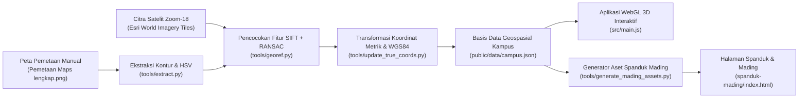

<div align="center">


&nbsp;&nbsp;&nbsp;&nbsp;

&nbsp;&nbsp;&nbsp;&nbsp;


# Denah Digital 3D Interaktif & Spanduk Mading<br/>Pesantren Modern Tgk. Chiek Oemar Diyan

**Program Kerja Mahasiswa-Mahasiswi Pengabdian Profesi Kepada Masyarakat (PPKPM)**  
**Universitas Islam Negeri (UIN) Ar-Raniry Banda Aceh**

[](https://threejs.org/)
[](https://vitejs.dev/)
[](https://www.python.org/)
[](https://maps.app.goo.gl/tD1gUuhmkMMjJH9aA)

📍 **Lokasi Kampus:** Jl. Tgk. Chiek Oemar Diyan, Krueng Lamkareung, Kec. Indrapuri, Kabupaten Aceh Besar, Aceh  
🌐 **Plus Code:** `9CXP+H7 Krueng Lamkareung, Kabupaten Aceh Besar, Aceh`  
🗺️ **Koordinat Titik Pusat (WGS84):** `5.399225976254173, 95.4357935984349` ([Buka di Google Maps](https://maps.app.goo.gl/tD1gUuhmkMMjJH9aA))

</div>

---

## 📋 Daftar Isi

1. [Tentang Proyek](#-tentang-proyek)
2. [Fitur Utama](#-fitur-utama)
   - [1. Peta 3D Geocoding Interaktif (`/`)](#1-peta-3d-geocoding-interaktif-)
   - [2. Halaman Spanduk & Mading Siap Cetak (`/spanduk-mading`)](#2-halaman-spanduk--mading-siap-cetak-spanduk-mading)
   - [3. Berkas Mandiri Offline (*Zero-Dependency HTML*)](#3-berkas-mandiri-offline-zero-dependency-html)
3. [Daftar 26 Bangunan & Fasilitas Terpetakan](#-daftar-26-bangunan--fasilitas-terpetakan)
4. [Arsitektur & Metodologi Pemetaan Geospasial](#-arsitektur--metodologi-pemetaan-geospasial)
5. [Struktur Direktori Proyek](#-struktur-direktori-proyek)
6. [Prasyarat & Instalasi](#-prasyarat--instalasi)
7. [Panduan Penggunaan & Skrip NPM](#-panduan-penggunaan--skrip-npm)
8. [Kontrol Navigasi & Pintasan Keyboard](#-kontrol-navigasi--pintasan-keyboard)
9. [Panduan Cetak Spanduk / Ekspor PDF 1 Halaman](#-panduan-cetak-spanduk--ekspor-pdf-1-halaman)
10. [Tim Penyusun & Pengabdian](#-tim-penyusun--pengabdian)

---

## 📖 Tentang Proyek

Repositori ini berisi sistem informasi pemetaan visual kampus **Pesantren Modern Tgk. Chiek Oemar Diyan** yang dikembangkan sebagai **Program Kerja Mahasiswa-Mahasiswi PPKPM dari UIN Ar-Raniry Banda Aceh**.

Proyek ini dirancang untuk menjawab dua kebutuhan utama pesantren sekaligus dalam satu basis kode terpadu:
1. **Media Eksplorasi Digital Interaktif 3D (`/`)** yang dapat diakses melalui perangkat *mobile* (HP/tablet) maupun komputer untuk memudahkan santri baru, wali santri, pengajar, dan tamu mengenali tata letak bangunan, jaringan jalan, fasilitas olahraga, serta titik koordinat GPS setiap gedung secara *real-time*.
2. **Media Cetak Spanduk & Papan Mading Informasi (`/spanduk-mading`)** beresolusi tinggi yang memadukan **Denah Ilustrasi**, **Denah Satelit**, **Keterangan 26 Bangunan**, **Legenda Warna**, **QR Code Google Maps**, dan **Galeri Foto Gedung Utama** dalam format 1 halaman horizontal (*landscape*) siap cetak.

---

## ✨ Fitur Utama

### 1. Peta 3D Geocoding Interaktif (`/`)

- **3 Mode Visualisasi Peta Real-Time:**
  - **Denah (Ilustrasi 3D):** Menampilkan diorama arsitektural 3D lengkap dengan bangunan beratap pelana/perisai/kubah, jaringan jalan kuning dan abu-abu, aliran sungai, lapangan olahraga bertekstur, serta pepohonan 3D.
  - **Hybrid (Satelit + 3D):** Memadukan citra satelit resolusi tinggi (*Zoom Level 18*) pada permukaan tanah dengan bangunan 3D, penanda nomor, dan pepohonan di atasnya.
  - **Satelit (Citra Satelit Murni):** Menampilkan citra ortofoto satelit asli area pesantren untuk inspeksi permukaan bumi secara langsung.
- **Tema Siang (Terang) & Malam (Gelap):**
  - **Mode Terang:** Pencahayaan matahari siang hari dengan bayangan lembut (*PCF Soft Shadow Map*) dan warna langit cerah.
  - **Mode Gelap:** Suasana malam hari dengan langit biru tua, pencahayaan bulan, dan jendela-jendela gedung pesantren yang menyala hangat secara prosedural.
- **Alat Interaksi Ramah Mobile & Desktop (HUD Dock):**
  - 🖱️ **Mode Klik (`select` / Tombol `V`):** Ketuk bangunan untuk melihat kartu informasi lengkap (nama, kategori, deskripsi, koordinat GPS WGS84, dan tautan Google Maps) serta geser untuk memutar kamera 3D.
  - ✋ **Hand Tool / Mode Geser (`pan` / Tombol `H`):** Memudahkan pengguna layar sentuh (HP) maupun mouse untuk menggeser (*panning*) peta ke segala arah cukup dengan **1 jari** tanpa memutar orientasi kamera.
  - 🔍 **Scale Tool / Mode Zoom (`zoom` / Tombol `Z`):** Geser vertikal 1 jari ke atas/bawah untuk memperbesar/memperkecil tampilan secara halus, atau ketuk titik pada peta untuk memperbesar ke lokasi tersebut.
  - 📊 **Indikator Persentase Zoom Real-Time (`#zoom-pct`):** Menampilkan tingkat perbesaran saat ini (misal `100%` pada pandangan Utara, `58%` pada pandangan Atas) di antara tombol `-` dan `+`. Mengetuk angka persentase akan mereset zoom kembali ke `100%`.
- **Klasifikasi Kerapatan Vegetasi Berbasis Satelit:**
  - Sebanyak **2.230 titik pohon 3D** ditempatkan secara otomatis berdasarkan analisis warna & tekstur citra satelit asli (membedakan zona hutan rimbun di sekeliling sungai/batas luar, pepohonan sedang di sekitar asrama, serta area terbuka seperti lapangan sepak bola).
  - Tersedia 3 pilihan kepadatan pohon pada panel pengaturan: **Tanpa** (`0%`), **Sedang** (`~45%`), dan **Asli / Lebat** (`100%`).
- **Pencarian Instan & Direktori Gedung:**
  - Pencarian *fuzzy* berdasarkan nama gedung, nomor urut (`1`–`26`), maupun kategori fasilitas.

---

### 2. Halaman Spanduk & Mading Siap Cetak (`/spanduk-mading`)

- **Tata Letak Presisi Sesuai Standar Spanduk Pesantren (`1600 × 1136 px`):**
  - **Header Utama:** Menampilkan emblem logo **Pesantren Modern Tgk. Chiek Oemar Diyan** beresolusi tinggi (`800 × 800 px`), tipografi vektor berlapis **`DENAH PESANTREN MODERN — TGK. CHIEK OEMAR DIYAN`**, lokasi `Krueng Lamkareung – Aceh Besar – Aceh`, serta kutipan motto pesantren.
  - **Panel Kiri & Tengah (Peta Ganda):** Menampilkan **Denah Ilustrasi** dan **Denah Satelit** secara berdampingan lengkap dengan kompas arah mata angin, skala meter (`0 – 200 Meter`), dan **26 lencana nomor interaktif** yang saling terhubung (*hover* atau klik pada satu nomor akan menyorot lokasi yang sama di kedua peta dan daftar keterangan).
  - **Pengalih Gaya Peta Spanduk:** Pengguna dapat memilih tampilan **Peta Spanduk (2.5D Berwarna)** atau **Render Perspektif 3D** melalui bilah alat di bagian atas.
  - **Panel Kanan:** Memuat daftar **Keterangan Bangunan (`1`–`26`)** dalam 2 kolom rapi serta **Legenda Warna** 8 kategori dan **QR Code Google Maps** yang dapat dipindai langsung menggunakan kamera HP.
  - **Galeri Foto Gedung Utama:** Menampilkan 8 kartu foto fasilitas utama (*Masjid*, *Gedung Kelas*, *Asrama Putra*, *Asrama Putri*, *Aula / Serbaguna*, *Perpustakaan*, *Gerbang Utama*, dan *Gerbang & Pos Satpam*).
  - **Footer Pengantar PPKPM UIN Ar-Raniry & Kartu Lokasi:** Dilengkapi penanda logo **UIN Ar-Raniry** dan **PPKPM 26**, narasi pengantar program kerja mahasiswa-mahasiswi PPKPM, serta kartu koordinat alamat pesantren.
- **Penskalaan Proporsional Otomatis & Cetak 1 Halaman Horizontal:**
  - Kanvas papan dikunci pada rasio `1600 × 1136 px` dan diskalakan secara proporsional di semua ukuran layar serta diatur dengan `@page { size: 423.33mm 300.57mm; margin: 0mm; }` sehingga ketika dicetak ke PDF/printer tidak pernah terpotong menjadi 2 halaman dan tidak menyempit.

---

### 3. Berkas Mandiri Offline (*Zero-Dependency HTML*)

Untuk kemudahan distribusi di lingkungan pesantren (misalnya melalui *flashdisk* atau komputer lokal tanpa koneksi internet/Node.js), proyek ini menyertakan generator berkas mandiri yang menggabungkan seluruh kode HTML, CSS, JavaScript, data JSON, dan tekstur gambar (dalam format *Base64 Data URI*) ke dalam satu berkas tunggal:
- **`denah_3d_offline.html`** — Aplikasi Peta 3D Interaktif lengkap dalam 1 berkas HTML.
- **`spanduk_mading_offline.html`** — Halaman Spanduk & Mading lengkap dalam 1 berkas HTML.
- **`public/spanduk_mading_pesantren.pdf`** — Berkas PDF Spanduk & Mading 1 halaman horizontal siap cetak.

---

## 🏛️ Daftar 26 Bangunan & Fasilitas Terpetakan

Seluruh bangunan dan fasilitas dikelompokkan ke dalam 6 kategori warna standar:

| No | Nama Bangunan / Fasilitas | Kategori | Kode Warna |
| :-: | :--- | :--- | :--- |
| **1** | **Gerbang Utama** | Fasilitas Umum & Pos | Abu-abu (`#64748b`) |
| **2** | **Pos Satpam** | Fasilitas Umum & Pos | Abu-abu (`#64748b`) |
| **3** | **Sekolah MTsN** | Pendidikan / Sekolah | Biru (`#2563eb`) |
| **4** | **Masjid Baburrayyan** | Ibadah (Masjid & Musalla) | Hijau Tua (`#15803d`) |
| **5** | **Kantin & Food Court** | Fasilitas Umum & Dapur | Abu-abu (`#64748b`) |
| **6** | **Asrama Putra** | Asrama Putra | Oranye (`#ea580c`) |
| **7** | **Tugu Globe** | Landmark & Monumen | Abu-abu (`#64748b`) |
| **8** | **Lapangan Basket** | Olahraga & Area Hijau | Hijau (`#16a34a`) |
| **9** | **Asrama Putra** | Asrama Putra | Oranye (`#ea580c`) |
| **10** | **Gedung Sekolah GTS** | Pendidikan / Sekolah | Biru (`#2563eb`) |
| **11** | **Lapangan Bola / Upacara** | Olahraga & Area Hijau | Hijau (`#16a34a`) |
| **12** | **Mess Ustad** | Asrama Putri & Mess | Merah (`#dc2626`) |
| **13** | **Ruang TU MA & MTsN, Perpustakaan, Ruang Guru & Aula** | Pendidikan / Kantor | Biru (`#2563eb`) |
| **14** | **Gedung Administrasi & Ruang Turkey** | Fasilitas Umum & Kantor | Abu-abu (`#64748b`) |
| **15** | **Ruang Makan Putra** | Fasilitas Umum & Dapur | Abu-abu (`#64748b`) |
| **16** | **Gedung Turkey / Gedung Sekolah** | Pendidikan / Sekolah | Biru (`#2563eb`) |
| **17** | **Musalla Putri** | Ibadah (Masjid & Musalla) | Hijau Tua (`#15803d`) |
| **18** | **Asrama Putri** | Asrama Putri & Mess | Merah (`#dc2626`) |
| **19** | **Dapur & Ruang Makan Putri** | Fasilitas Umum & Dapur | Abu-abu (`#64748b`) |
| **20** | **Kantin Putri & Mess Ustazah** | Asrama Putri & Mess | Merah (`#dc2626`) |
| **21** | **Asrama Putri** | Asrama Putri & Mess | Merah (`#dc2626`) |
| **22** | **Aula STB** | Pendidikan / Aula | Biru (`#2563eb`) |
| **23** | **Lapangan Pesantren** | Olahraga & Area Hijau | Hijau (`#16a34a`) |
| **24** | **Lapangan Bulu Tangkis** | Olahraga & Area Hijau | Hijau (`#16a34a`) |
| **25** | **Lapangan Asrama Putra** | Olahraga & Area Hijau | Hijau (`#16a34a`) |
| **26** | **Lapangan Voli** | Olahraga & Area Hijau | Hijau (`#16a34a`) |

---

## 🧭 Arsitektur & Metodologi Pemetaan Geospasial

Untuk memastikan posisi setiap gedung, jalan, lapangan, sungai, dan pepohonan pada denah 3D maupun spanduk mading **100% akurat sesuai kondisi geografis aslinya**, proyek ini menggunakan pipa pemrosesan geospasial berbasis Python:



### Tahapan Teknis:
1. **Akuisisi Citra Satelit Orthophoto (`tools/georef.py`):**
   Mengunduh dan menyatukan (*stitching*) ubin citra satelit resolusi tinggi (*Zoom Level 18*, resolusi `~0.59 meter/piksel`) di sekitar titik pusat GPS pesantren (`5.399226° U, 95.435794° T`).
2. **Registrasi Citra Otomatis (*SIFT Feature Matching + RANSAC Affine Homography*):**
   Mencocokkan titik-titik kunci antara gambar pemetaan manual (`Mentahan/Pemetaan Maps Tanpa penomoran.png`) dengan citra satelit untuk memperoleh matriks transformasi georeferensi presisi tinggi.
3. **Ekstraksi Poligon Bangunan, Jalan, Sungai, & Klasifikasi Vegetasi (`tools/update_true_coords.py`):**
   - Mengekstrak koordinat poligon setiap gedung, orientasi atap (*Oriented Bounding Box / OBB*), jaringan jalan utama/lingkungan, batas wilayah pesantren, dan alur sungai.
   - Menganalisis indeks kehijauan dan variasi tekstur kanopi pada citra satelit untuk mengklasifikasikan 2.230 pohon ke dalam zona hutan lebat (`forest`), pepohonan sedang (`sparse`), dan area terbuka.
4. **Render 3D WebGL (`src/main.js`):**
   Membangun geometri ekstrusi 3D (`THREE.ExtrudeGeometry`), atap arsitektural (kubah Masjid Baburrayyan, atap limasan/perisai dengan *overhang*, tekstur fasad jendela berlapis), penanda nomor mengambang, serta pemetaan UV citra satelit secara *real-time*.

---

## 📂 Struktur Direktori Proyek

```text
denah/
├── index.html                        # Halaman utama Peta 3D Interaktif (/)
├── spanduk-mading/
│   └── index.html                    # Halaman Spanduk & Mading (/spanduk-mading)
├── spanduk-mading.html               # Salinan fallback rute /spanduk-mading.html
├── denah_3d_offline.html             # Berkas mandiri (offline) Peta 3D Interaktif
├── spanduk_mading_offline.html       # Berkas mandiri (offline) Spanduk & Mading
├── vite.config.js                    # Konfigurasi Vite MPA & middleware clean URL
├── package.json                      # Konfigurasi dependensi & skrip NPM
├── src/
│   ├── main.js                       # Engine utama Three.js, kamera, raycasting, & HUD 3D
│   ├── style.css                     # Desain antarmuka HUD Peta 3D (Desktop & Mobile)
│   ├── spanduk.js                    # Logika interaktif, skala layar, & cetak Spanduk Mading
│   └── spanduk.css                   # Layout & aturan cetak 1 halaman Spanduk Mading
├── public/
│   ├── spanduk_mading_pesantren.pdf  # Output PDF Spanduk Mading siap cetak (1 halaman horizontal)
│   ├── data/
│   │   ├── campus.json               # Data poligon 3D, jalan, sungai, pohon, & koordinat GPS
│   │   └── mading_markers.json       # Koordinat terukur 26 lencana nomor pada peta mading
│   └── textures/
│       ├── satellite.jpg             # Citra satelit Zoom-18 area pesantren
│       ├── mading_logo.png           # Emblem resolusi tinggi (800x800) Pesantren Oemar Diyan
│       ├── logo-uin.png              # Logo resmi UIN Ar-Raniry Banda Aceh
│       ├── logo-ppkpm.png            # Logo resmi PPKPM 26 UIN Ar-Raniry
│       ├── mading_ilustrasi.jpg      # Peta ilustrasi 2.5D resolusi tinggi untuk spanduk
│       ├── mading_satelit.jpg        # Peta satelit dengan overlay atap untuk spanduk
│       ├── render_3d_ilustrasi.png   # Render perspektif 3D mode ilustrasi
│       ├── render_3d_satelit.png     # Render perspektif 3D mode hybrid satelit
│       └── gedung_1.jpg .. gedung_8.jpg # 8 foto gedung utama pesantren
├── image/
│   ├── logo-uin.png                  # Sumber aset logo UIN Ar-Raniry
│   └── logo-ppkpm.png                # Sumber aset logo PPKPM 26
├── Mentahan/                         # Berkas referensi desain, wireframe, & pemetaan awal
└── tools/                            # Skrip Python pemrosesan geospasial & generator aset
    ├── georef.py                     # Unduh citra satelit & registrasi SIFT + RANSAC
    ├── extract.py                    # Ekstraksi kontur bangunan & jalan dari peta referensi
    ├── update_true_coords.py         # Sinkronisasi koordinat sejati & klasifikasi vegetasi
    ├── generate_mading_assets.py     # Generator logo 800x800, peta mading, & titik marker
    └── generate_standalone.py        # Bundler HTML mandiri (single-file offline generator)
```

---

## ⚙️ Prasyarat & Instalasi

### Prasyarat Perangkat Lunak
- **Node.js** versi `18.0.0` atau lebih baru (beserta `npm`).
- **Python** versi `3.9+` *(opsional — hanya diperlukan apabila ingin menjalankan ulang skrip ekstraksi geospasial atau memperbarui berkas mandiri `offline.html`)* dengan paket:
  ```bash
  pip install numpy opencv-python pillow
  ```

### Langkah Instalasi
1. **Kloning repositori ini:**
   ```bash
   git clone https://github.com/<username>/denah-pesantren-oemar-diyan.git
   cd denah-pesantren-oemar-diyan
   ```
2. **Instal seluruh dependensi JavaScript:**
   ```bash
   npm install
   ```

---

## 🚀 Panduan Penggunaan & Skrip NPM

### 1. Menjalankan Server Pengembangan Lokal (*Development Server*)
```bash
npm run dev
```
Setelah server berjalan, buka di *browser*:
- **Peta 3D Interaktif:** `http://localhost:5173/`
- **Spanduk & Mading:** `http://localhost:5173/spanduk-mading`

### 2. Membangun Versi Produksi (*Production Build*)
```bash
npm run build
```
Hasil kompilasi yang telah diminifikasi akan tersimpan di dalam folder `dist/`. Untuk meninjau hasil *build* produksi secara lokal:
```bash
npm run preview
```

### 3. Membangun Berkas Mandiri Offline (`denah_3d_offline.html` & `spanduk_mading_offline.html`)
```bash
npm run standalone
```
Perintah ini menjalankan `vite build` diikuti oleh `python tools/generate_standalone.py` untuk memperbarui kedua berkas HTML mandiri bebas-server.

### 4. Memperbarui Aset Grafis Spanduk & Mading
```bash
python tools/generate_mading_assets.py
```

---

## 🎮 Kontrol Navigasi & Pintasan Keyboard

### Kontrol Peta 3D (`/`)

| Aksi | Mouse (Desktop) | Layar Sentuh (Mobile / HP) | Pintasan Keyboard |
| :--- | :--- | :--- | :---: |
| **Mode Klik & Putar** | Klik bangunan / Klik kiri + tahan untuk putar | Ketuk bangunan / Geser 1 jari untuk putar | `V` |
| **Hand Tool (Geser Peta)** | Klik kiri + tahan lalu geser (atau Klik kanan + geser) | Geser 1 jari ke segala arah | `H` |
| **Scale Tool (Zoom Halus)** | Klik kiri + geser vertikal (atau *Scroll Wheel*) | Geser 1 jari naik/turun (atau cubit 2 jari) | `Z` |
| **Reset Zoom ke `100%`** | Klik indikator persentase zoom (`100%`) | Ketuk indikator persentase zoom (`100%`) | — |
| **Arahkan ke Utara** | Klik tombol Kompas / Preset Utara | Ketuk tombol Kompas / Preset Utara | `N` |
| **Cari Bangunan** | Klik kolom pencarian di kiri atas | Ketuk kolom pencarian di kiri atas | `/` |
| **Tutup Panel / Modal** | Klik tombol `×` | Ketuk tombol `×` | `Esc` |

---

## 🖨️ Panduan Cetak Spanduk / Ekspor PDF 1 Halaman

Halaman `/spanduk-mading` telah dikonfigurasi secara khusus agar menghasilkan cetakan **1 halaman penuh secara horizontal (*landscape*)** tanpa ada elemen yang terpotong maupun kolom yang menyempit:

1. Buka halaman `http://localhost:5173/spanduk-mading` menggunakan Google Chrome atau Microsoft Edge.
2. Klik tombol hijau **`Cetak / Simpan PDF`** di pojok kanan atas (atau tekan `Ctrl + P`).
3. Pada dialog cetak:
   - **Destination / Printer:** Pilih `Save as PDF` (atau printer fisik Anda).
   - **Margins:** Pilih `None` / `Default` (ukuran halaman `@page` otomatis mengikuti rasio bentang spanduk `423.33mm × 300.57mm`).
   - **Background graphics:** Pastikan opsi **Background graphics** dicentang.
4. Atau gunakan langsung berkas PDF siap cetak yang telah tersedia di [`public/spanduk_mading_pesantren.pdf`](public/spanduk_mading_pesantren.pdf).

---

## 🤝 Tim Penyusun & Pengabdian

Proyek pemetaan digital dan spanduk mading ini disusun dan dipersembahkan oleh:

- **Pelaksana:** Mahasiswa-Mahasiswi **Pengabdian Profesi Kepada Masyarakat (PPKPM)**
- **Perguruan Tinggi:** **Universitas Islam Negeri (UIN) Ar-Raniry Banda Aceh**
- **Lokasi Pengabdian:** **Pesantren Modern Tgk. Chiek Oemar Diyan**, Krueng Lamkareung, Kec. Indrapuri, Kabupaten Aceh Besar, Provinsi Aceh.

> *“Mencetak Generasi Berilmu, Berakhlak Mulia dan Siap Mengabdi untuk Umat dan Bangsa”*

---

<div align="center">
  <sub>Dikembangkan dengan ❤️ oleh Mahasiswa-Mahasiswi PPKPM UIN Ar-Raniry Banda Aceh untuk Pesantren Modern Tgk. Chiek Oemar Diyan.</sub>
</div>
